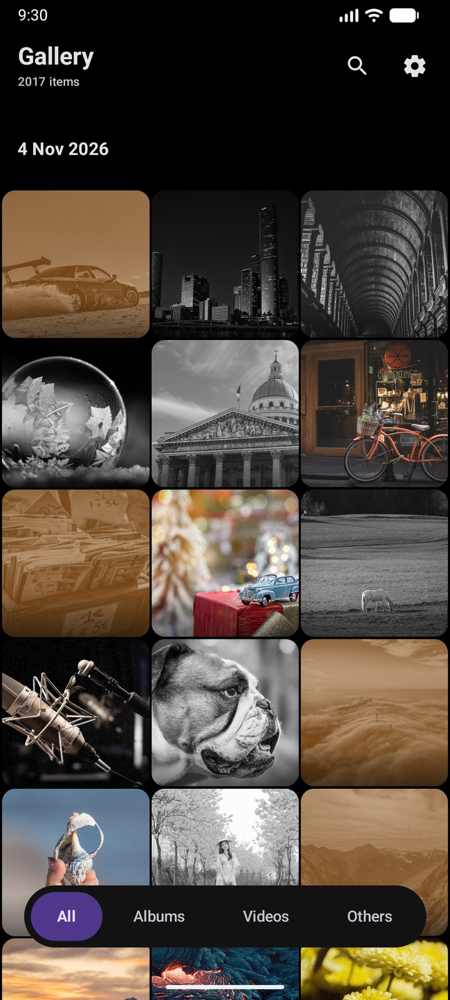
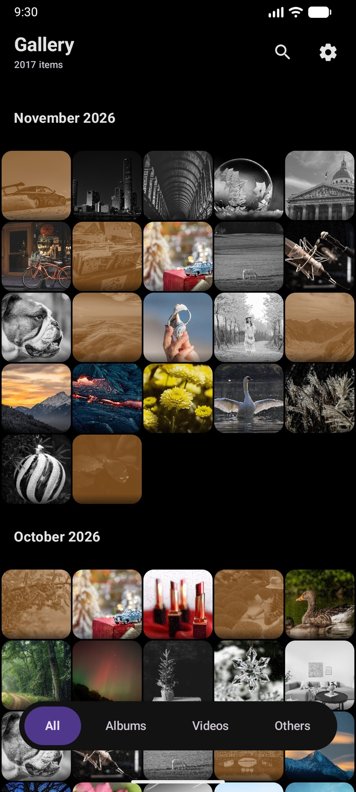
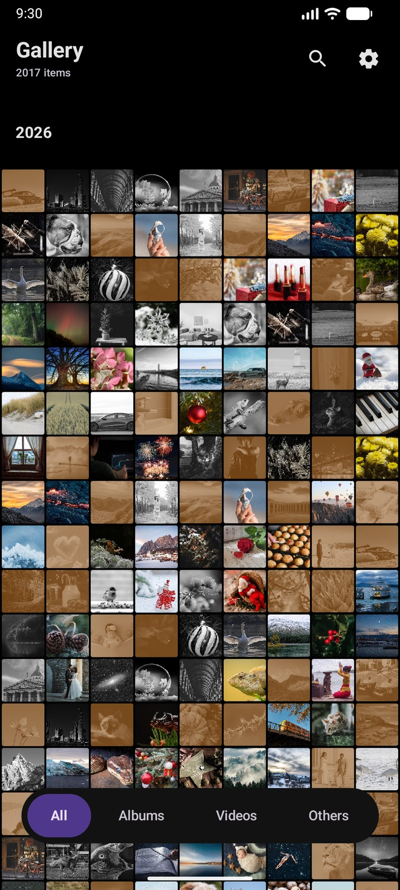
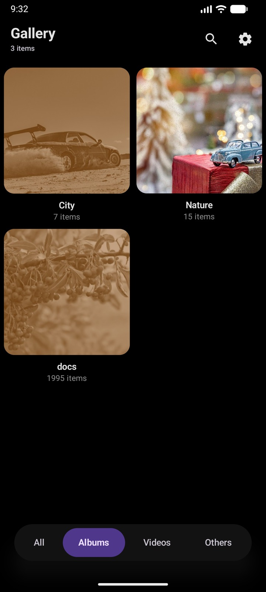
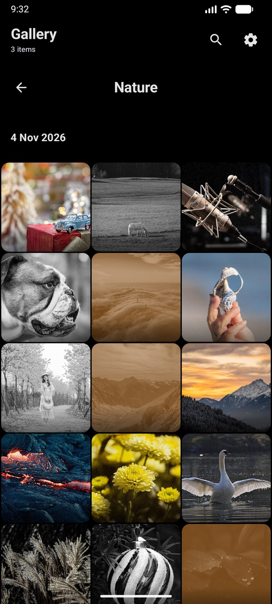
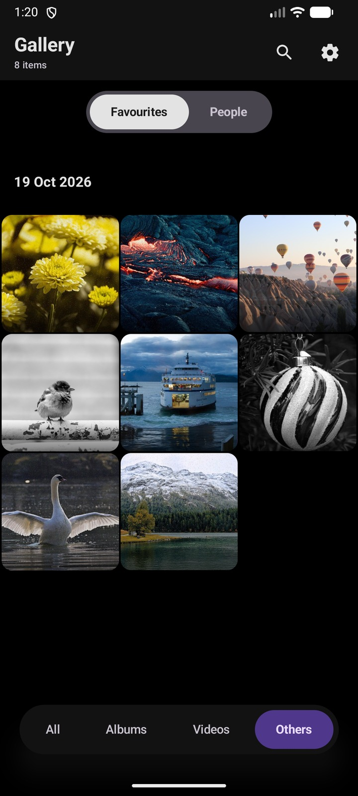
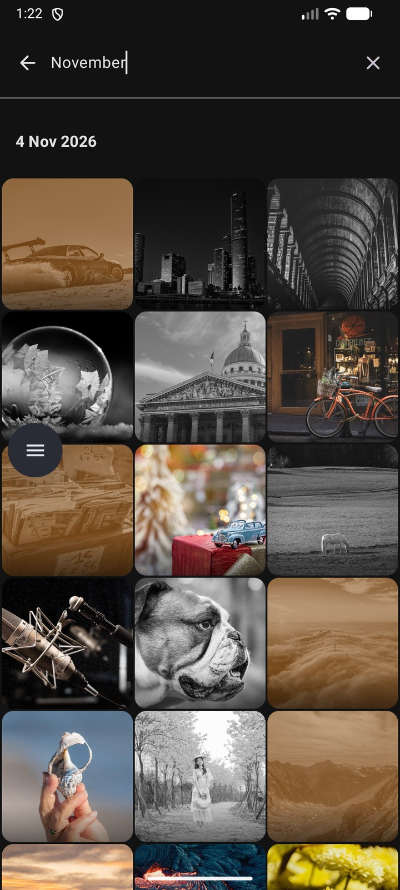
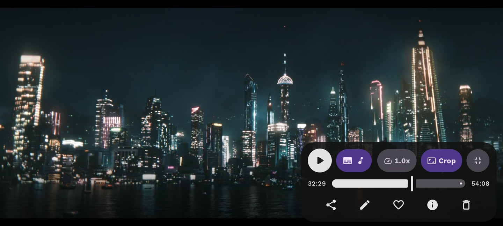

<div align="center">

# Chronicle

**A private, fast photo and video gallery for Android, built entirely in Jetpack Compose.**

[](https://kotlinlang.org)
[](https://developer.android.com/jetpack/compose)
[](https://dagger.dev/hilt/)
[](https://developer.android.com/training/data-storage/room)
[](https://www.tensorflow.org/lite)
[](https://developers.google.com/ml-kit)

Browse, play, organise, search, map, and find people in your library. Your photos, videos and face data never leave the device. No accounts, no uploads, no analytics.

</div>

---

## Overview

Chronicle is a full local gallery: your photos and videos, grouped the way you actually think about them, wrapped in an interface that moves well and gets out of the way.

It is built on a strict MVI architecture with a single source of truth per screen, and the ML work is treated as a first class citizen rather than a bolt-on. Face indexing has real progress, real pause and resume, and survives app kills and reboots. A second background pass extracts GPS coordinates so the same library can be browsed on a map.

**Package** `com.myurrrjj.chronicle` · **Min SDK** 26 · **Target SDK** 37 · **Version** 1.4 (code 4) · **Language** Kotlin · **UI** 100% Compose

---

## Screenshots

### Homescreen

Pinch the grid to move between Day, Month and Year grouping.

| Day | Month | Year |
|:---:|:---:|:---:|
|  |  |  |

### Albums

| Album grid | Album opened |
|:---:|:---:|
|  |  |

### Favourites

| Favourites |
|:---:|
|  |

### Search

| Search |
|:---:|
|  |

### Video player

<p align="center"></p>

---

## Features

### Browse the whole library

Four tabs: **All**, **Albums**, **Videos**, and **Others** (Favourites or People). Albums are built from your real folder structure via MediaStore bucket names, not a heuristic.

Three grouping modes drive the timeline: **Day**, **Month** and **Year**. Each one changes both the header format (`d MMM yyyy`, `MMMM yyyy`, `yyyy`) and the minimum cell size — 120dp, 80dp and 50dp — so the grid gets denser as you zoom out.

**Pinch the grid** to move between them. The gesture is a custom `galleryZoomGesture` with a 1.3x / 0.7x threshold and a haptic tick on every transition, so the change feels deliberate rather than accidental.

The layout is adaptive: on an expanded-width window the floating tab bar becomes a navigation rail.

### Find people

On-device face indexing, described in full below. Face detection with ML Kit, 128 dimension embeddings from a TFLite model, and greedy cosine clustering into person groups you can rename and open as their own gallery.

### Look at a photo

Tap any thumbnail and it flows into the full viewer on a **shared element transition**, keyed per media item. The viewer is a horizontal pager over the current scope, so you can swipe through the album, person or search result you came from. Inside it: pinch and double tap zoom, tap to hide the chrome, and a full metadata sheet.

### Play a video

A custom control surface over ExoPlayer with:

- Playback speed control
- Three resize modes: fit, crop, stretch
- Audio track selection
- Subtitle track selection with an overlay renderer
- A seek step you set in Settings
- Landscape handoff and auto hiding controls

### Organise

Long press to enter selection mode, then act on the whole selection at once:

- **Share** one or many through the system chooser
- **Favourite** or unfavourite the whole selection
- **Delete** through MediaStore
- **Copy** the content URIs to the clipboard (offered only when the selection contains no videos)

Single items additionally get **Edit**, which hands off to any installed editor, and **Info** for the full metadata sheet.

The contextual bar and floating action bar appear and retreat based on selection and scroll state, so the grid stays clean when you are just looking.

### Inspect a photo

The info sheet is built from staggered animated sections: camera make and model, resolution, and then either megapixels, aperture, exposure, ISO and focal length for photos, or duration, frame rate and bitrate for videos. A location card shows the place name and drops a MapLibre pin.

Details for the current page are prefetched as you swipe, so opening the sheet is usually instant.

### Search

An FTS4 index built over the library. It indexes:

- File name
- Folder name
- Type words (`photo`, `image`, `video`, `mp4`)
- Favourite status
- The full date string

Queries are prefix matched per word, so `aug beach` finds beach photos from August. Typing is debounced at 300 ms and results are grouped by the current view mode.

### Browse on a map

A MapLibre screen over every geotagged item in the library. Pins are clustered on a grid in Web Mercator pixel space, so they merge as you zoom out and separate as you zoom in. Tapping a cluster of one opens the photo; tapping a cluster of many zooms until it splits. Place names come from a local cache of reverse geocode results.

### Make it yours

- Auto play videos on or off
- Seek step for the video player
- Default grouping mode on launch
- Face indexing schedule: manual, on app open, charging only, or overnight
- Automatic pause on low battery and on low storage
- Light and dark themes following the system, edge to edge, Material 3

### Design details

The interface is animated on purpose, not decoratively:

- Shared element transitions between grid, album, person and detail views
- `bouncyClick`, a spring scale press effect used on every card and control
- `AnimatedContent` tab transitions with directional slide and fade
- Animated segmented controls that morph their background colour
- Floating bars that appear on scroll up and hide on scroll down
- Staggered, animated rows inside the info sheet

---

## How face indexing works

This is the part worth reading before you touch the code.

```
MediaStore
   |
   v
BitmapLoader           decode to a 1024px target, EXIF rotation applied, RGB_565
   |
   v
MlKitFaceDetector      ACCURATE mode, all landmarks + classification, minFaceSize 0.05
   |                   rejects: box <112px on either side, aspect ratio outside 0.60–2.50,
   |                   any head euler angle beyond 60 degrees
   v
FaceCropper            5 point similarity transform onto the ArcFace 112x112 template
   |                   (falls back to bounding box + 20% margin when landmarks are missing)
   v
FaceEmbedder           sface TFLite, CPU only, 128 dimension vector
   |
   v
Room transaction       embeddings + per photo ledger, atomically
   |
   v
FaceClusterer          greedy cosine similarity, threshold 0.5
   |
   v
People tab             covers, counts, rename
```

**Batching.** Photos are processed in batches of 20. Each batch commits through a single Room transaction — embeddings, the per photo ledger rows, and the deletions they replace — so a batch is whole or absent.

**Pause and resume** are cooperative, not cancellable. A persisted flag in DataStore is read only at batch boundaries, so a batch of 20 photos always commits whole or not at all. Resume continues from the first photo not in the ledger. Force stop exists as an escape hatch and is safe because the batch commit is a single Room transaction and orphaned embeddings are re-clustered at the start of the next run.

**Progress** is a merge of four sources: WorkManager state, the persisted pause flag, live per photo counters held in memory, and durable counts from Room. `FaceIndexingController` is the single owner of every action, shared by both the gallery and settings screens.

**Face crops** are written to app private storage as `filesDir/face_crops/{mediaId}_{faceIndex}.jpg` at JPEG quality 95, for the person covers. Reset deletes the database rows and the crop files; your photos are never touched.

**Failures.** An `OutOfMemoryError` stops the run permanently with a resume hint instead of retrying. Other exceptions retry up to three attempts before the run is marked failed.

---

## How the photo map works

A separate WorkManager pass (`LocationIndexingWorker`) extracts coordinates, because reading GPS tags is expensive enough to keep off the face pipeline:

```
MediaStore
   |
   v
MediaLocationExtractor   EXIF GPS for photos (setRequireOriginal on Android 10+ so redacted
   |                     EXIF still resolves), ISO 6709 GPS for videos
   v
media_location           one row per geotagged item, indexed on lat/lng and bucketKey
   |
   v
ReverseGeocodeHelper     one lookup per coordinate bucket, cached in place_cache
   |
   v
PhotoMapScreen           grid clustered pins, tap to separate, tap to open
```

The pass runs in batches of 100, prunes rows for media that no longer exists, and is refreshed by a 12 hour periodic worker. Geocoding is skipped when the device is offline; the pins still render from coordinates alone.

---

## Tech stack

| Area | Choice |
|---|---|
| Language | Kotlin 2.3.20 |
| UI | Jetpack Compose, Material 3 1.5.0-alpha16, Compose BOM 2026.09.00 |
| Adaptive layout | Material 3 adaptive 1.1.0, window size classes |
| Architecture | MVI, unidirectional data flow |
| DI | Dagger Hilt 2.60.1, androidx Hilt 1.3.0 |
| Local storage | Room 2.8.5, DataStore Preferences 1.2.1 |
| Image loading | Coil 2.7.0 with a custom MediaStore thumbnail fetcher |
| Video | Media3 ExoPlayer 1.11.1 |
| ML | ML Kit face detection 16.1.7, TensorFlow Lite 2.16.1 |
| Maps | MapLibre Compose 0.18.0, SubsamplingScaleImageView 3.10.0 |
| Background work | WorkManager 2.11.2 with Hilt integration |
| Navigation | Navigation Compose 2.9.8, type safe routes |
| Serialization | kotlinx.serialization 1.8.0 |
| Coroutines | kotlinx-coroutines 1.10.2, kotlinx-collections-immutable 0.3.8 |
| Build | AGP 9.1.1, Gradle 9.3.1, JDK 17, KSP 2.3.12 |

---

## Architecture

### Layers

```
presentation/   Compose screens, MVI contracts, ViewModels
domain/         Models, repository interfaces, use cases
data/           MediaStore, Room, DataStore implementations
core/           MVI base classes, ML pipeline, indexing controllers, utilities
worker/         WorkManager jobs
di/             Hilt modules
```

Dependencies point inward. The domain layer knows nothing about Android, Room, or Compose.

### MVI

Every screen has a contract of three types: `State`, `Event`, `Effect`. `BaseViewModel` exposes a `StateFlow<State>`, consumes events from a `SharedFlow`, and emits one shot effects over a `Channel`.

```
UI dispatches Event  ->  ViewModel reduces State  ->  UI recomposes
                     ->  Effect (navigation, share, delete)
```

### Database

`GalleryDatabase`, version 7, with eight entities and auto migrations from 5 through 7:

| Table | Purpose |
|---|---|
| `favourite_media` | Favourited media ids |
| `face_embeddings` | One row per detected face: 128 float vector, bounding box, source media |
| `face_clusters` | One row per person: label, cover embedding, timestamps |
| `media_person` | Join table, cascade deletes from both parents |
| `media_processing_status` | The face indexing ledger, one row per processed photo |
| `search_index` | FTS4 table for search |
| `media_location` | Coordinates per media item, indexed for map bounds queries |
| `place_cache` | Reverse geocode results per coordinate bucket |

Schemas are exported to `app/schemas/`.

---

## Project structure

```
app/src/main/java/com/myurrrjj/chronicle/
├── core/
│   ├── indexing/        FaceIndexingController, LocationIndexingController,
│   │                    progress trackers
│   ├── ml/              MlKitFaceDetector, FaceCropper, FaceEmbedder,
│   │                    FaceQualityAssessor, FaceClusterer
│   ├── presentation/    BaseViewModel, MVI contracts, modifiers, indexing UI
│   └── util/            BitmapLoader, MediaLocationExtractor, ReverseGeocodeHelper,
│                        NativeThumbnailFetcher, ThumbnailSizes, MediaIntents
├── data/
│   ├── local/           GalleryDatabase, DAOs, entities, converters
│   └── repository/      MediaStore, Face, Search, Settings implementations
├── di/                  Hilt modules
├── domain/
│   ├── model/           MediaAsset, PersonCluster, AppSettings, FaceIndexingProgress
│   ├── repository/      Interfaces
│   └── usecase/         GroupMediaUseCase, GetFilteredMediaUseCase, ClusterPhotoPinsUseCase
├── presentation/
│   ├── gallery/         GalleryViewModel, screens, components
│   ├── map/             PhotoMapScreen, PhotoMapViewModel
│   ├── navigation/      Type safe routes, NavGraph, window layout
│   ├── search/          Search screen and ViewModel
│   ├── settings/        Settings screen and ViewModel
│   └── editor/          Editing state models
├── previews/            Responsive Compose previews
├── trial/               Face Quality Lab, a developer tool
├── ui/theme/            Colours, typography, theme
└── worker/              FaceIndexingWorker, LocationIndexingWorker
```

---

## Getting started

### Requirements

- Android Studio with AGP 9.1.1 support
- JDK 17
- Android SDK 37
- A physical device for anything involving the camera roll or ML

### Build

```bash
git clone https://github.com/myurrrjj/Chronicle-Gallery-App.git
cd Chronicle-Gallery-App
./gradlew :app:assembleDebug
```

### Build variants

| Variant | Minified | Application ID |
|---|---|---|
| `debug` | no | `com.myurrrjj.chronicle.debug` |
| `release` | R8 + resource shrinking | `com.myurrrjj.chronicle.testRelease` |
| `benchmark` | R8, same as release | `com.myurrrjj.chronicle.testRelease` |

The suffix lets a debug build sit alongside a release build on one device; release and benchmark share theirs, so installing one replaces the other. Release and benchmark signing both read `keystore.properties` from the repository root (`storeFile`, `storePassword`, `keyAlias`, `keyPassword`); that file is gitignored, so a release build needs it present before Gradle will configure.

### The face model

The embedding model is **not** in this repository. It is gitignored and must be added before face indexing will do anything:

```
app/src/main/assets/sface_embedder_fp32.tflite
```

`FaceEmbedder` expects input `[1, 112, 112, 3]` — floats in 0–255, channels in **B, G, R** order — and output `[1, 128]`, and validates both shapes at load time. If the file is missing, the app still runs, but indexing completes with zero faces and no error, so check this first if the People tab stays empty.

---

## Performance

Startup and scroll performance are measured, not assumed:

- `baselineprofile1/` generates a baseline profile, which is merged into the main source set and ships in the APK
- `benchmark/` holds macrobenchmarks: cold startup timing, plus scroll and pinch journeys across Day, Month and Year (`FrameTimingMetric`)
- `log_benchmark.py` appends each run to an Excel tracker so regressions are visible across builds

Thumbnails are fetched from MediaStore at bucketed sizes (128 to 512 px) through a custom Coil fetcher, with a 25% memory cache and a 256 MB disk cache, so grid cells never decode more than they display.

---

## Permissions

| Permission | Why |
|---|---|
| `READ_MEDIA_IMAGES` | Browsing the full photo library, building albums, indexing |
| `READ_MEDIA_VIDEO` | The Videos tab and the video timeline |
| `READ_MEDIA_VISUAL_USER_SELECTED` | Partial access on Android 14 and above |
| `READ_EXTERNAL_STORAGE` | Same, on API 32 and below only |
| `ACCESS_MEDIA_LOCATION` | Reading GPS tags from photos whose EXIF Android has redacted |
| `POST_NOTIFICATIONS` | Indexing progress notification |
| `FOREGROUND_SERVICE`, `FOREGROUND_SERVICE_DATA_SYNC` | Keeping indexing alive while you leave the app |
| `INTERNET` | Map tiles and reverse geocoding only — see Privacy |

A system picker cannot replace the media permissions. Chronicle needs to enumerate the whole library, read folder structure for Albums, and keep persistent access so indexing can run across sessions.

---

## Privacy

Photos and videos never leave the device, and neither do face embeddings.

- No analytics, no crash reporting service, no accounts, no telemetry
- Photos and videos are read through MediaStore and never copied or uploaded
- Face embeddings are computed locally and stored in a local Room database
- Face crops are written to app private storage under `filesDir/face_crops`
- Uninstalling the app, or tapping Reset in the People tab, deletes all of it

Two features do reach the network, and they are worth naming plainly:

- **The photo map** loads its style and tiles from `tiles.openfreemap.org`, so the tile provider sees which part of the world you are looking at. Your photos are not part of that request.
- **Reverse geocoding** goes through the system `Geocoder` to turn a coordinate into a place name. On most devices that is backed by Google Play services, so the coordinates of a location bucket are sent to it. Results are cached locally, and the lookup is skipped entirely when the device is offline.

Both are limited to coordinates and map viewport. No photo, video, face embedding or person label is ever transmitted.

---

## Release builds

Release builds run R8 with resource shrinking. Rules live in `app/proguard-rules.pro` and cover the things that actually break under obfuscation here: kotlinx.serialization route lookups, the WorkManager worker class name, enum names persisted to DataStore, TensorFlow Lite JNI, ML Kit internals, MapLibre, and the `PlayerView` constructor used by layout inflation.

`app/build/outputs/mapping/release/mapping.txt` is the only way to read a production stack trace. Archive it with every release.

---

## Roadmap

- [ ] In app photo editor. `PhotoEditState` and `CropRect` exist as models, nothing renders them yet
- [ ] Face indexing for videos, currently images only
- [ ] Merge or split person clusters after the fact
- [ ] Album covers and pinning
- [ ] Re-index a single photo without a full reset
- [ ] Offline map style, so the map stops needing tiles from a third party

---

## Contributing

Issues and pull requests are welcome. If you are changing the ML pipeline, run the Face Quality Lab first: it takes a labelled photo set, shows every detection decision and quality metric (face size, clipping, Laplacian variance, mean luminance, luminance spread, landmark count), and sweeps cosine thresholds so you can pick one from data rather than by guessing.

The lab lives in `trial/` and is wired to its own navigation route, but the button that opened it from Settings is currently commented out — re-enable that item in `SettingsScreen.kt` to reach it while working on the pipeline.

Two small things worth knowing before you change the pipeline:

- The embedding threshold lives in `FaceClusterer.MATCH_THRESHOLD` and is `0.5f`
- `FaceCropper` falls back to a padded bounding box when landmarks are missing, which means aspect ratio distortion before the 112x112 scale. If faces from odd angles cluster badly, that is the first place to look

---


